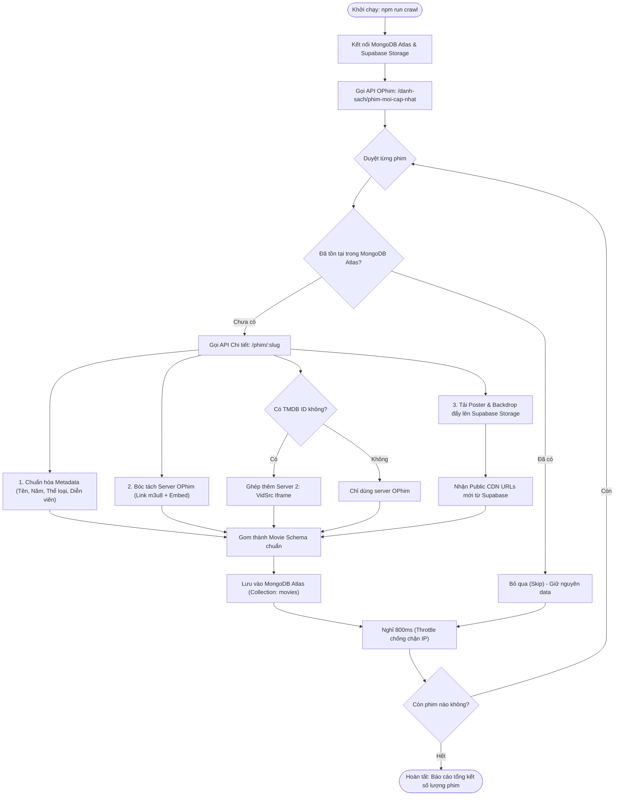

# CẨM NANG KỸ THUẬT: HỆ THỐNG WORKER CÀO DỮ LIỆU PHIM (CRAWLER PIPELINE)

> **Tài liệu lưu trữ nội bộ nhóm phát triển CineVerse**  
> **Người phụ trách:** Nguyễn Duy Thái Bảo (Trưởng nhóm / Backend & Core Infrastructure)  
> **Giai đoạn:** Phase 2 - Cào Dữ Liệu & Quản lý Kho Nội dung  
> **Thời gian hoàn thiện:** 23/10/2026  

---

## 1. MỤC ĐÍCH HỆ THỐNG (LÀM CHI?)

Trong các nền tảng Streaming chuyên nghiệp như Netflix hay Disney+, dữ liệu phim không thể phụ thuộc vào việc người dùng bấm vào web rồi web mới đi gọi API bên ngoài (sẽ gây chậm trễ, gián đoạn, lỗi giao diện khi API nguồn sập hoặc đổi link).

**Worker Crawler của CineVerse được xây dựng nhằm giải quyết các bài toán:**
1. **Làm chủ dữ liệu (Data Ownership):** Tự động cào và chuẩn hóa hàng chục đến hàng trăm bộ phim về cơ sở dữ liệu MongoDB Atlas riêng của nhóm.
2. **Khắc phục triệt để lỗi "chết ảnh" (Broken Images):** Thay vì dùng link ảnh tạm thời của web lậu (rất dễ bị chặn hoặc die link), script tự động tải file ảnh về và đẩy lên **Supabase Storage** (CDN đám mây riêng của CineVerse).
3. **Cơ chế phát đa nguồn (Multi-server Streaming):** Tự động tích hợp cả 2 server phát cùng lúc vào mỗi bộ phim:
   * **Server 1:** OPhim (chạy file stream `.m3u8` qua thư viện Player HLS.js chất lượng cao, có thuyết minh/Vietsub).
   * **Server 2:** VidSrc (nhúng qua `iframe` quốc tế dự phòng dựa trên TMDB ID).
4. **Phục vụ trọn vẹn các tính năng tiếp theo của nhóm:**
   * Cung cấp dữ liệu phim để **Nam** làm giao diện Grid, phân trang và thanh tìm kiếm realtime (Phase 4).
   * Cung cấp danh sách tập để **Nguyên** làm API lưu lịch sử xem phim và phân quyền VIP (Phase 3 & 4).
   * Cung cấp mảng thể loại, diễn viên, đạo diễn chuẩn hóa để **Bảo** xây dựng thuật toán **AI Recommendation** (Phase 5).

---

## 2. KIẾN TRÚC LUỒNG XỬ LÝ (LÀM RA SAO?)

### 2.1. Sơ đồ Pipeline tổng thể



---

## 3. CÁCH TRIỂN KHAI TRONG MÃ NGUỒN (LÀM NHƯ THẾ NÀO?)

### 3.1. Phân chia module phụ trách
Hệ thống được tách bạch thành các tầng dịch vụ độc lập, đảm bảo nguyên tắc Clean Architecture:

* **[`models/movieModel.js`](file:///c:/Users/ASUS-PRO/Desktop/Rottos/web%20advanced/project/cineverse/models/movieModel.js):** 
  * Định nghĩa Mongoose Schema chuẩn.
  * Thiết lập mảng `danh_sach_server` hỗ trợ linh hoạt cả `m3u8` và `iframe`.
  * Đánh `Text Index` trên `title` và `origin_name` để hỗ trợ tìm kiếm full-text nhanh chóng.
* **[`services/ophimService.js`](file:///c:/Users/ASUS-PRO/Desktop/Rottos/web%20advanced/project/cineverse/services/ophimService.js):**
  * Hàm `getLatestMovies(page)`: Gọi endpoint danh sách phim mới nhất kèm cơ chế fallback tự động giữa `ophim1.com` và `phimapi.com`.
  * Hàm `getMovieDetail(slug)`: Bóc tách toàn bộ thông tin chi tiết và danh sách tập của phim.
* **[`services/supabaseService.js`](file:///c:/Users/ASUS-PRO/Desktop/Rottos/web%20advanced/project/cineverse/services/supabaseService.js):**
  * Hàm `uploadImageFromUrl(imageUrl, fileName, folder)`: Dùng `axios` tải ảnh dưới dạng binary `Buffer`, xác định MIME type và gọi SDK `@supabase/supabase-js` đẩy vào bucket `cineverse-movies`.
  * Trả về đường link CDN vĩnh viễn: `https://[project-ref].supabase.co/storage/v1/object/public/cineverse-movies/...`
* **[`scripts/crawlMovies.js`](file:///c:/Users/ASUS-PRO/Desktop/Rottos/web%20advanced/project/cineverse/scripts/crawlMovies.js):**
  * Script thực thi dòng lệnh (CLI Runner).
  * Điều phối toàn bộ quy trình: Kết nối DB $\rightarrow$ Quét trang $\rightarrow$ Kiểm tra trùng lặp $\rightarrow$ Xử lý ảnh $\rightarrow$ Ghép server $\rightarrow$ Lưu DB $\rightarrow$ Log tiến độ.

---

### 3.2. Cấu trúc 1 bản ghi Phim hoàn chỉnh trong MongoDB Atlas
Sau khi cào, mỗi bộ phim được lưu trữ chuẩn mực như sau:

```json
{
  "_id": "67192a8e8f8d...",
  "title": "Trường Hè, 2001",
  "origin_name": "Summer School, 2001",
  "slug": "truong-he-2001",
  "overview": "Nội dung tóm tắt phim...",
  "poster_url": "https://bplmbrgfuojhmhhewmhj.supabase.co/storage/v1/object/public/cineverse-movies/posters/truong-he-2001-poster.jpg",
  "backdrop_url": "https://bplmbrgfuojhmhhewmhj.supabase.co/storage/v1/object/public/cineverse-movies/backdrops/truong-he-2001-backdrop.jpg",
  "year": 2025,
  "type": "single",
  "quality": "HD",
  "lang": "Vietsub",
  "isVip": false,
  "view_count": 520,
  "genres": [
    { "name": "Chính Kịch", "slug": "chinh-kich" },
    { "name": "Gia Đình", "slug": "gia-dinh" },
    { "name": "Tâm Lý", "slug": "tam-ly" }
  ],
  "danh_sach_server": [
    {
      "server_name": "Vietsub",
      "server_type": "m3u8",
      "server_data": [
        {
          "name": "Full",
          "slug": "full",
          "link_m3u8": "https://a.kvp726.com/20261023/NVTdAnUh/index.m3u8",
          "link_embed": "https://player.phimapi.com/player/?url=https://a.kvp726.com/20261023/NVTdAnUh/index.m3u8"
        }
      ]
    },
    {
      "server_name": "VidSrc Dự Phòng (Iframe)",
      "server_type": "iframe",
      "server_data": [
        {
          "name": "Full",
          "slug": "full",
          "link_m3u8": "",
          "link_embed": "https://vidsrc.xyz/embed/movie?tmdb=1481097"
        }
      ]
    }
  ]
}
```

---

## 4. HƯỚNG DẪN VẬN HÀNH DÒNG LỆNH (CLI USAGE GUIDE)

Toàn bộ các tùy chọn chạy cào phim đã được đăng ký vào `npm run crawl`. Bạn có thể chạy linh hoạt theo các chế độ sau:

### 4.1. Chế độ Test: Cào 1 phim duy nhất theo slug
Dùng để kiểm tra nhanh khi phát hiện 1 bộ phim mới hoặc muốn cào thử nghiệm:
```bash
node scripts/crawlMovies.js --slug=truong-he-2001
```

### 4.2. Chế độ Tiêu chuẩn: Cào theo số lượng trang (Khuyên dùng)
Mỗi trang tương ứng với 24 bộ phim.
* **Cào 1 trang (24 phim mẫu ban đầu):**
  ```bash
  npm run crawl -- --pages=1
  ```
* **Cào 3 trang (~72 phim - Chuẩn mực nhất cho đồ án CineVerse):**
  ```bash
  npm run crawl -- --pages=3
  ```
* **Cào từ trang 2 trở đi (nếu đã cào trang 1 trước đó):**
  ```bash
  npm run crawl -- --page=2 --pages=2
  ```

### 4.3. Tùy chỉnh tốc độ nghỉ giữa các request (Throttle)
Mặc định script nghỉ 800ms giữa mỗi phim. Nếu mạng chậm hoặc muốn cào thong thả hơn:
```bash
npm run crawl -- --pages=3 --delay=1200
```

---

## 5. CÁC CƠ CHẾ AN TOÀN & CHỐNG LỖI (FAULT TOLERANCE)

1. **Tính chất Idempotent (Chống trùng lặp tuyệt đối):**
   * Trước khi cào chi tiết, script luôn tra cứu `Movie.findOne({ slug })`.
   * Nếu phim đã có trong database, script sẽ lập tức bỏ qua (`Skip`) và chuyển sang phim tiếp theo, không gọi upload ảnh thừa thãi, không tốn băng thông và không bao giờ bị lỗi trùng khóa (Duplicate Key Error).
2. **Cơ chế Fallback bảo vệ ảnh:**
   * Quá trình upload ảnh lên Supabase được bao bọc trong khối `try/catch` độc lập.
   * Nếu có một bức ảnh gốc từ web phim bị lỗi 404 hoặc mạng bị đứt giữa chừng, script sẽ tự động dùng lại URL gốc thay vì làm sập toàn bộ quy trình cào phim.
3. **Cơ chế Fallback Domain API:**
   * Script tự động chuyển đổi giữa `ophim1.com` và `phimapi.com` khi gặp lỗi HTTP 404 hoặc 500 từ máy chủ nguồn.
4. **Giải phóng tài nguyên sạch sẽ:**
   * Khi hoàn tất hoặc gặp lỗi fatal, script luôn gọi `await mongoose.disconnect()` để đóng toàn bộ kết nối tới MongoDB Atlas, không để lại kết nối rác (Connection Leaks).
